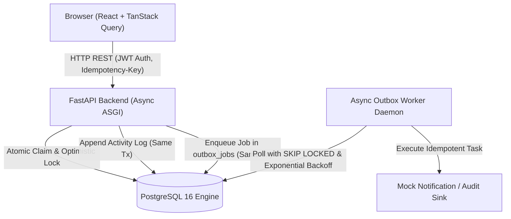

# Operations Under Pressure — Newtonite Engineering Challenge

**Candidate Roll Number:** `23131010924`  
**Repository:** `newtonite-ops-23131010924`  
**Tech Stack:** Python 3.12 (FastAPI, SQLAlchemy Async, asyncpg, Pydantic v2), PostgreSQL 16, React 18 (Vite, TanStack Query, Tailwind CSS), Docker Compose  

---

## 1. What the App Does

**Operations Under Pressure** is an internal web operations platform engineered for cross-team incident and work item orchestration under high concurrency. Built to handle volatile operational environments (payment discrepancies, compliance flags, infrastructure outages, and customer escalations), it guarantees correctness under race conditions, enforces server-side role-based access control (RBAC), maintains an append-only audit trail in the same database transaction, and reliably dispatches asynchronous side-effects using the transactional outbox pattern.

---

## 2. Architecture Diagram



---

## 3. Critical Behaviors Beyond CRUD (All Implemented & Tested)

Newtonite specifically evaluates systems on how they behave under real-world pressure:

| Situation | Engineered Solution | Automated Test |
| :--- | :--- | :--- |
| **Two users claim the same item** | Atomic conditional update (`UPDATE work_items SET assignee_id = :user_id WHERE id = :id AND assignee_id IS NULL`). Exactly one succeeds (`200`); colliding request receives `409 Conflict`. | `tests/test_concurrent_claims.py` fires 2 concurrent claims using `asyncio.gather`; exactly one succeeds. |
| **Editing a stale version** | Optimistic locking on integer `version` field. Mismatch returns `409 Conflict` with the latest record snapshot and rolls back UI state. | `tests/test_optimistic_locking.py` confirms stale updates are rejected and database data remains intact. |
| **Repeated request (double-click, retry)** | `Idempotency-Key` header with SHA-256 request fingerprinting. Stored in `idempotency_keys` inside the same transaction; replays return cached response with `Idempotent-Replay: true`. | `tests/test_idempotency.py` asserts replayed keys return single item without duplicate side-effects. |
| **Workflow rules & Approval gate** | Server-enforced state machine (`Open` → `In Progress` → `Awaiting Approval` → `Resolved` → `Closed`). Advancing from `Awaiting Approval` to `Resolved` strictly requires a team `Lead` or `Admin` role. | `tests/test_workflow_permissions.py` verifies illegal jumps are blocked with 400 and non-Lead approvals receive 403. |
| **Resource-level authorization** | Team-scoped RBAC (`Viewer`, `Member`, `Lead`, `Admin`). Server-side dependency injection checks membership on every read/write. | `tests/test_resource_authorization.py` verifies cross-team operations return 403 Forbidden. |
| **Reliable async work** | Transactional outbox pattern: side-effects are written to `outbox_jobs` in the primary transaction. Worker polls with `FOR UPDATE SKIP LOCKED`, exponential backoff, and max-retry dead-letter caps. | `tests/test_outbox_worker.py` verifies retry progression, backoff calculation, and idempotent completion. |
| **Optimistic UI reconciliation** | React frontend optimistically updates UI, rolls back state, and surfaces clear conflict alerts if the server rejects a stale version or race collision. | Covered in frontend TanStack Query mutation lifecycle and error boundary. |

---

## 4. Prerequisites & Quick Start

### Prerequisites
- [Docker](https://docs.docker.com/get-docker/) & [Docker Compose](https://docs.docker.com/compose/) installed and running.
- Alternatively for local dev: Python 3.12+ and Node.js 20+.

### Running with One Command (Docker)

```bash
# Clone the repository
git clone https://github.com/your-username/newtonite-ops-23131010924.git
cd newtonite-ops-23131010924

# Build and start all services (PostgreSQL, Backend API, Worker, Frontend, Database Seeder)
docker compose up --build
```

### Service Access Points
- **Web Dashboard**: [http://localhost:5173](http://localhost:5173)
- **FastAPI Interactive Docs**: [http://localhost:8000/docs](http://localhost:8000/docs)
- **PostgreSQL Database**: `localhost:5432` (`user: postgres`, `password: postgres`, `db: newtonite_ops`)

---

## 5. Demo Login Credentials

The seeder automatically initializes 3 operational teams (**Payments Operations**, **Compliance & Security**, and **Core Infrastructure**) and seeded accounts across all roles.

The web UI includes a **1-click Persona Switcher** on the top right to instantly test authorization.

| Email | Password | Assigned Teams & Roles | Purpose / Testing Use Case |
| :--- | :--- | :--- | :--- |
| `lead.payments@newtonite.internal` | `password123` | Payments (Lead), Core Infra (Member) | Approve transitions, reassign items, full lead actions |
| `member.payments@newtonite.internal` | `password123` | Payments (Member) | Create, claim, and advance items to Awaiting Approval |
| `viewer.payments@newtonite.internal` | `password123` | Payments (Viewer) | Verify read-only enforcement (403 on mutation) |
| `lead.compliance@newtonite.internal` | `password123` | Compliance (Lead) | Cross-team isolation check (cannot view or touch Payments) |
| `member.compliance@newtonite.internal` | `password123` | Compliance (Member) | Team-scoped compliance work items |
| `lead.infra@newtonite.internal` | `password123` | Core Infra (Lead) | Infrastructure operational triage |
| `admin@newtonite.internal` | `password123` | All Teams (Admin) | Global administrative oversight |

> **Scale Demonstration:** The seeder inserts over **1,200 work items** across teams with indexes on `(team_id, status)`, `(team_id, priority)`, and `(team_id, created_at, id)` to prove efficient keyset cursor pagination.

---

## 6. How to Run Automated Tests

### Run tests inside Docker (One command):
```bash
docker compose run --rm test
```

### Run tests locally (Virtual Environment):
```bash
cd backend
python -m venv .venv
source .venv/bin/activate  # On Windows: .venv\Scripts\activate
pip install -r requirements.txt
pytest -v
```

---

## 7. Known Limitations & Deliberate Trade-offs

1. **No External Notification Provider**: Email delivery and external push notifications are routed to an in-memory outbox worker audit sink to eliminate external cloud dependencies during evaluation.
2. **Polling Outbox Worker vs. CDC**: The outbox worker uses `SELECT ... FOR UPDATE SKIP LOCKED` polling at a 2-second interval. In high-scale distributed production, PostgreSQL `LISTEN/NOTIFY` or Debezium CDC into Kafka would be preferred.
3. **No WebSockets**: The dashboard uses TanStack Query background refetching and window-focus sync instead of WebSockets, keeping the operational footprint lightweight, simple, and reliable.

---


